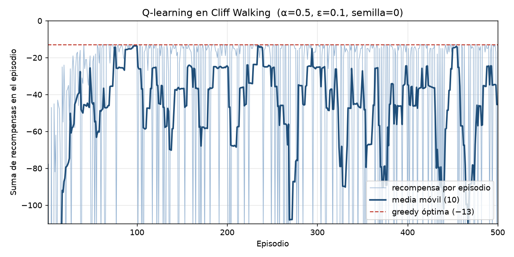

# Reporte — Ejercicio 01: Q-learning en Cliff Walking

## 1. Trabajo realizado

Se implementó **Q-learning tabular** con conducta **ε-greedy** sobre el mundo **Cliff Walking** de Sutton y Barto (cuadrícula de $4 \times 12$). Antes de programar se corrió el proyecto de referencia (`project/`: `02_one_update.py`, `03_train.py` y `04_compare.py --only sarsa`) para revisar un backup de Q-learning en el pasillo de tres casillas. 

La solución es un programa en:

- `solucion-01/cliff_qlearning.py`: entorno $4 \times 12$, tabla Q, ε-greedy, actualización de Q-learning, entrenamiento, evaluación greedy y gráfica.
- `solucion-01/recompensas_por_episodio.csv`: recompensa de los 500 episodios de entrenamiento, media móvil de 10 y número de caídas por episodio.
- `solucion-01/curva_recompensa.png`: curva de recompensa por episodio.

```bash
cd "Q-learning/Ejercicio 1/solucion-01"
python cliff_qlearning.py            # corrida reportada (semilla 0)
python cliff_qlearning.py --seed 7   # cualquier otra semilla
```

---

## 2. Entorno y parámetros

### A. Entorno (libro)

```
fila\col   0  1  2  3  4  5  6  7  8  9  10 11
0          .  .  .  .  .  .  .  .  .  .  .  .
1          .  .  .  .  .  .  .  .  .  .  .  .
2          .  .  .  .  .  .  .  .  .  .  .  .
3          S  C  C  C  C  C  C  C  C  C  C  G
```

- Paso ordinario (incluye chocar con el borde y entrar a G): $r = -1$.
- Pisar el acantilado `C`: $r = -100$, el agente **vuelve a S** y el episodio **continúa**.
- Entrar a G `(3, 11)` es lo único que termina el episodio (o el tope de 200 pasos).
- Desempate en $\arg\max$: orden fijo **N, E, S, W** (gana la primera).

Comprobación de los tres casos a mano (el programa los verifica con `assert` al arrancar):

| Estado $s$ | Acción | $s'$ | $r$ | ¿Termina? |
|:---:|:---:|:---:|:---:|:---:|
| S = `(3, 0)` | N | `(2, 0)` | −1 | no |
| S = `(3, 0)` | E | S = `(3, 0)` (cae) | −100 | no |
| `(2, 11)` | S | G = `(3, 11)` | −1 | **sí** |

### B. Parámetros de la corrida

| Parámetro | Valor |
|---|:---:|
| $\alpha$ | 0.5 |
| $\gamma$ | 1 |
| $\varepsilon$ | 0.1 |
| Episodios | 500 |
| Q inicial | 0 |
| Tope de pasos por episodio | 200 |
| **Semilla** (`random.Random`) | **0** |

Regla de actualización implementada (`q_update`):

$$Q(s, a) \leftarrow Q(s, a) + \alpha \left[ r + \gamma \max_{a'} Q(s', a') - Q(s, a) \right]$$

con $\max_{a'} Q(s', a') = 0$ solo si $s'$ es G.

---

## 3. Resultados Obtenidos

### A. Política greedy ($\varepsilon = 0$)

Flechas de la acción greedy en cada casilla; los corchetes `[ ]` marcan el camino recorrido desde S:

```text
fila\col  0   1   2   3   4   5   6   7   8   9   10  11
0         →   →   →   →   →   →   →   ↓   →   →   ↓   ↓
1         ↓   ↓   →   →   →   →   ↓   →   →   ↓   →   ↓
2        [→] [→] [→] [→] [→] [→] [→] [→] [→] [→] [→] [↓]
3        [S↑] C   C   C   C   C   C   C   C   C   C   G
```

- **Camino:** `(3,0) → (2,0) → (2,1) → … → (2,11) → (3,11)`
- **Acciones:** `N E E E E E E E E E E E S`
- **Pasos:** **13** — **Retorno greedy:** **−13** (llega a G por la fila 2, pegada al acantilado).

Valores aprendidos en S: $Q(S, N) = -13.000$ y $Q(S, E) = -113.000$.

Para verificar que el resultado no depende de la semilla elegida, se repitió la corrida con las semillas 1, 2, 3, 4, 5 y 42: en todas la política greedy recorre el mismo camino de 13 pasos con retorno −13.

### B. Recompensa por episodio durante el entrenamiento (ε-greedy encendida)



| Episodios | Recompensa media |
|:---:|:---:|
| 1 – 10 | −268.00 |
| 11 – 50 | −58.90 |
| 51 – 100 | −27.82 |
| 101 – 200 | −39.57 |
| 201 – 300 | −42.66 |
| 301 – 400 | −50.85 |
| 401 – 500 | −48.71 |

Muestreo de la serie cada 50 episodios (la serie completa está en `recompensas_por_episodio.csv`):

```text
==========================================================
 Episodio | Recompensa | Media móvil (10) | Caídas
==========================================================
    50    |    -124    |      -44.30      |   1
   100    |     -17    |      -13.80      |   0
   150    |     -13    |      -36.80      |   0
   200    |     -13    |      -24.50      |   0
   250    |     -15    |      -25.70      |   0
   300    |     -13    |      -25.20      |   0
   350    |     -13    |      -27.20      |   0
   400    |    -118    |      -34.70      |   1
   450    |     -13    |      -14.90      |   0
   500    |     -13    |      -45.40      |   0
==========================================================
```

- Peor episodio: **−893** (episodio 2, cortado por el tope de 200 pasos tras 7 caídas). Solo **2** de los 500 episodios llegaron al tope, ambos al inicio.
- Mejor episodio: **−13**, alcanzado en **171** episodios.
- **109** episodios incluyen al menos una caída al acantilado (147 caídas en total).
- La media de los episodios 101–500 se estabiliza alrededor de **−45**, por debajo de −13, igual que la curva de Q-learning en la figura del libro.

---

## 4. Respuestas a las Preguntas

### Pregunta 1: ¿Por qué el camino de 13 pasos, pegado al acantilado, es óptimo?

**Respuesta:**
Con $\gamma = 1$ el retorno es la suma de recompensas. Como cada paso que no cae cuesta exactamente −1, **maximizar el retorno equivale a minimizar el número de pasos** sin pisar el acantilado (una sola caída, −100, ya es peor que cualquier rodeo razonable).

S está en `(3, 0)` y G en `(3, 11)`: hay que avanzar **11 columnas** al este. Pero toda la fila 3 entre ambos es acantilado, así que el agente debe **subir al menos 1 fila** y luego **bajar 1 fila** para entrar a G. La cota mínima es:

$$1 \ (\text{N}) + 11 \ (\text{E}) + 1 \ (\text{S}) = 13 \ \text{pasos} \quad\Rightarrow\quad G_{\text{óptimo}} = -13$$

Cualquier camino por la fila 1 o la fila 0 necesita subir y bajar más filas (15 o 17 pasos, retorno −15 o −17). El único camino que alcanza la cota es el que va por la **fila 2**, inmediatamente encima del acantilado. Por eso coincide con lo aprendido: $Q(S, N) = -13$.

---

### Pregunta 2: ¿Por qué la curva de entrenamiento queda por debajo de −13 aunque la política greedy ya sea óptima?

**Respuesta:**
Porque la curva mide la **política de comportamiento** (ε-greedy con $\varepsilon = 0.1$), no la política greedy que se evalúa al final.

Mientras camina por la fila 2, en cada paso el agente elige una acción al azar con probabilidad $0.1$, y esa acción es **S** (sur) con probabilidad $1/4$. Así, en cada casilla de la fila 2 la probabilidad de caer es de

$$\varepsilon \cdot \tfrac{1}{4} = 0.025$$

y a lo largo de las ~12 casillas peligrosas del camino:

$$P(\text{al menos una caída}) \approx 1 - (1 - 0.025)^{12} \approx 0.26$$

Aproximadamente uno de cada cuatro episodios suma un −100 y además tiene que recorrer otra vez el camino desde S (por eso aparecen episodios de −118, −224, −534…). Es justo lo observado: **109 de 500** episodios tuvieron caídas, y la media se queda alrededor de −45 aunque el $\arg\max$ ya apunte al camino óptimo desde el episodio 75 (con la misma semilla, entrenar 50 episodios todavía no llega a G en modo greedy; con 75 ya da −13).

Q-learning es **off-policy**: aprende los valores de la política greedy (blanco con $\max_{a'}$) e ignora en su objetivo que la exploración seguirá tirándolo al acantilado. Por eso elige el camino más corto pero más arriesgado bajo ε-greedy. Al apagar la exploración ($\varepsilon = 0$) ese riesgo desaparece y el retorno es exactamente −13.

---

### Pregunta 3: En el paso que cae al acantilado, ¿cuál es $s'$ en el backup de Q-learning, y por qué ese backup no trata el acantilado como estado terminal?

**Respuesta:**
En el paso que cae, el entorno devuelve **$s' = S$ = `(3, 0)`** con $r = -100$ y `terminado = False`. La casilla `C` nunca llega a ser el estado siguiente: el agente aparece de inmediato en la salida. Por lo tanto el backup es

$$Q(s, a) \leftarrow Q(s, a) + \alpha \left[ -100 + \gamma \max_{a'} Q(S, a') - Q(s, a) \right]$$

No se trata como terminal porque **el episodio continúa**: después de caer, el agente todavía tiene que caminar desde S hasta G y pagar todos esos pasos. Si se tomara el futuro como 0, el valor de caer sería solo −100, cuando en realidad es $-100 + V(S)$. Usar $\max_{a'} Q(S, a')$ suma ese costo restante.

En la tabla final se ve directamente: $\max_{a'} Q(S, a') = Q(S, N) = -13$, así que el blanco de dar E desde S es

$$-100 + 1 \cdot (-13) = -113 = Q(S, E)$$

Ese es justo el valor aprendido. En `project/envs/cliff.yaml` (3×5) el acantilado sí es terminal, y por eso ese entorno no sirve como solución de este ejercicio.
